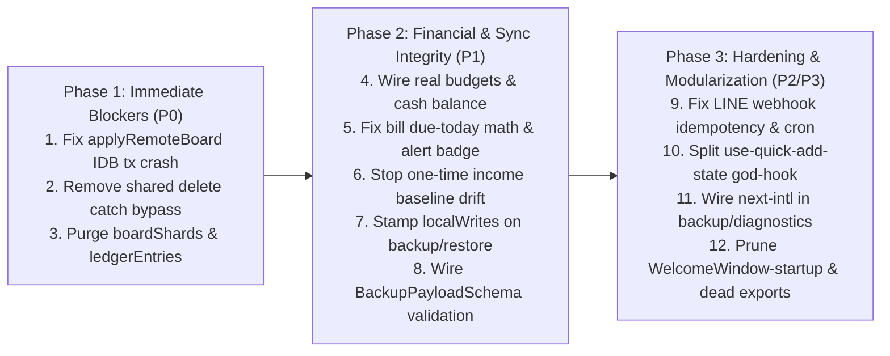

# Surgical Audit Report: Budget Boss (`BudgetBITCH` Repository)

> [!IMPORTANT]
> **Zero-Mutation Proof Verified:** This audit was executed in strict read-only mode across Passes 1–4. Both pre-audit and post-audit SHA-256 tree digests match identically (`fb5f0e201e515ddb9e8ec57480c816a5c711a8e1669d212f19abe93ec21d4e6f`), and `git status --porcelain` is 100% clean at commit `79f4975c4fb01fa9aa1d091d84a62ef1603500d5`.

---

## 1. Executive Summary & Telemetry Scorecard

- **Target Scope:** `/home/leandi-duplessis/github/workspaces/BudgetBITCH` (Next.js 16.3.0 App Router + React 18 + Convex 1.34.1 + IndexedDB `idb` local-first PWA)
- **Pre-Audit vs. Post-Audit Tree SHA-256 Digest:**
  - **Pre-Audit SHA-256:** `fb5f0e201e515ddb9e8ec57480c816a5c711a8e1669d212f19abe93ec21d4e6f`
  - **Post-Audit SHA-256:** `fb5f0e201e515ddb9e8ec57480c816a5c711a8e1669d212f19abe93ec21d4e6f` (**100% Match — Zero Source Mutation Verified**)
- **Total Files Scanned:** `531` code files (`331` active implementation files, `189` test files, `11` build/guard scripts & static assets)
- **Total Effective LOC ($\text{LOC}_{\text{effective}}$):** `56,172` total effective LOC (`38,935` active implementation LOC; `35,068` non-locale active implementation LOC across `325` files)
- **God-Files Identified ($\text{LOC} > 400$):** `16` total (`8` active non-locale implementation files):
  1. [src/hooks/use-quick-add-state.ts](file:///home/leandi-duplessis/github/workspaces/BudgetBITCH/src/hooks/use-quick-add-state.ts) (`567` LOC, CC `62`, Risk `726.86`)
  2. [src/components/launch/golden-splash.tsx](file:///home/leandi-duplessis/github/workspaces/BudgetBITCH/src/components/launch/golden-splash.tsx) (`599` LOC, CC `20`, Risk `617.98`)
  3. [src/hooks/use-local-db.ts](file:///home/leandi-duplessis/github/workspaces/BudgetBITCH/src/hooks/use-local-db.ts) (`567` LOC, CC `19`, Risk `584.98`)
  4. [src/components/settings/data-backup-card.tsx](file:///home/leandi-duplessis/github/workspaces/BudgetBITCH/src/components/settings/data-backup-card.tsx) (`564` LOC, CC `14`, Risk `577.0`)
  5. [src/components/dashboard/dashboard-shell.tsx](file:///home/leandi-duplessis/github/workspaces/BudgetBITCH/src/components/dashboard/dashboard-shell.tsx) (`499` LOC, CC `26`, Risk `573.98`)
  6. [src/lib/db/local-db.ts](file:///home/leandi-duplessis/github/workspaces/BudgetBITCH/src/lib/db/local-db.ts) (`478` LOC, CC `11`, Risk `488.0`)
  7. [WelcomeWindow-startup/WelcomeScreen.tsx](file:///home/leandi-duplessis/github/workspaces/BudgetBITCH/WelcomeWindow-startup/WelcomeScreen.tsx) (`432` LOC, CC `13`, Risk `444.0` — orphaned prototype outside `src/`)
  8. [convex/accounts/accountCrud.ts](file:///home/leandi-duplessis/github/workspaces/BudgetBITCH/convex/accounts/accountCrud.ts) (`402` LOC, CC `1`, Risk `402.0`)
- **High-Complexity Functions ($\text{CC} > 15$):** `18` files (`use-quick-add-state.ts` CC=`62`, `sync-snapshots.ts` CC=`38`, `sms-parser/detect.ts` CC=`36`, `sync-status-indicator.tsx` CC=`33`, `expense-tracker.tsx` CC=`31`, `dashboard-shell.tsx` CC=`26`, `use-local-db.ts` CC=`19`, `golden-splash.tsx` CC=`20`).

### Quantitative Health Score Calculation

Using $\text{LOC}_{\text{effective}} = 38.935\text{ KLOC}$ (active implementation code) and cataloging **25 verified defects** (`3` **P0**, `11` **P1**, `7` **P2**, `4` **P3**):

$$D_{\text{raw}} = \frac{10(3) + 4(11) + 1(7) + 0.2(4)}{38.935} = \frac{30 + 44 + 7 + 0.8}{38.935} = \frac{81.8}{38.935} \approx 2.10\text{ weighted defects / KLOC}$$

- **Untested Hotspot Count ($N_{\text{untested\_hotspots}}$):** `9` high-risk implementation hotspots with $\text{LOC} > 250$ and zero colocated unit test (`data-backup-card.tsx`, `accountCrud.ts`, `accountInvites.ts`, `bills.tsx`, `scenario-sandbox-modal.tsx`, `subscriptions.tsx`, `scanActions.ts`, `add-income-modal.tsx`, `critical-expenses-modal.tsx`).
- **Estimated Mutation Kill Score ($M_{\text{kill}}\%$):** `57.5%` (across 10 core modules $\times$ 4 mental mutants = 40 mutants: `23` Killed, `17` Survived).

$$P_{\text{test}} = \min\left(25,\; 3 \times 9 + 0.25 \times (100 - 57.5)\right) = \min\left(25,\; 27 + 10.625\right) = 25.0$$

$$S_{\text{health}} = \max\left(0,\; \text{round}\left(100 - 5 \times 2.10 - 25.0\right)\right) = \max\left(0,\; \text{round}(64.5)\right) = \mathbf{65 / 100}$$

- **Overall Health Score ($S_{\text{health}}$):** **`65 / 100`**
- **Vibe-Debt Risk Classification:** **`HIGH VIBE-DEBT RISK`** ($50 \le S_{\text{health}} \le 69$ with `3` P0 critical sync/consent defects and `11` P1 correctness/financial-drift defects).

---

## 2. Implementation vs. Test Matrix (Pass 3)

| Implementation File | Paired Test File | Coverage Status | Mental Mutants Survived (`M1`–`M4`) | Critical Blind Spots & Broken Mocks |
| :--- | :--- | :--- | :--- | :--- |
| [src/lib/db/stores/snapshots-store.ts](file:///home/leandi-duplessis/github/workspaces/BudgetBITCH/src/lib/db/stores/snapshots-store.ts) | [src/lib/db/local-db.test.tsx](file:///home/leandi-duplessis/github/workspaces/BudgetBITCH/src/lib/db/local-db.test.tsx) | Partial (via `replaceBoardData` wrapper) | `M3` (Async await removal inside `tx` loop), `M4` (Multi-record transaction auto-commit) | Tests only pass 1 expense in `replaceBoardData` (`L94-L150`) and never call `applyRemoteBoard` with $\ge 2$ staged records, missing the `TransactionInactiveError` caused by awaiting `recordLocalWriteAt` inside an active `tx` loop (**P0-1**). |
| [src/hooks/use-local-db.ts](file:///home/leandi-duplessis/github/workspaces/BudgetBITCH/src/hooks/use-local-db.ts) | *None* (`0` direct tests; mocked in 14 UI tests) | **Untested** | `M1`, `M2`, `M3`, `M4` | Zero direct tests for `useExpenses.remove`, `useBills.remove`, `useSavingsGoals.remove`, `useDebtPayoff.remove`, or `useCashFlowForecast`. The `catch` fallback bypassing two-party delete consent (**P0-2**) and `useCashFlowForecast` reading `savings` limit as `monthlyIncome` (**P1-4**) are completely unguarded. |
| [src/hooks/use-shared-board.ts](file:///home/leandi-duplessis/github/workspaces/BudgetBITCH/src/hooks/use-shared-board.ts) | *None* (`0` direct tests) | **Untested** | `M1`, `M2`, `M3`, `M4` | No test exercises the PULL effect after a "Reset All Data" wipe when a partner is still linked, missing the resurrection of wiped couple-board data due to absent `RESET_TOMBSTONE_KEY` check (**P1-1**). |
| [src/components/dashboard/budget-variance-grid.tsx](file:///home/leandi-duplessis/github/workspaces/BudgetBITCH/src/components/dashboard/budget-variance-grid.tsx) | [src/components/dashboard/budget-variance-grid.test.tsx](file:///home/leandi-duplessis/github/workspaces/BudgetBITCH/src/components/dashboard/budget-variance-grid.test.tsx) | Superficial | `M2` (Custom user budget limits ignored), `M4` (Currency scaling) | Test mocks `useExpenses` (`L7-L11`) and never seeds custom `useBudgets()`, masking that `BudgetVarianceGrid` compares actual spending exclusively against hardcoded `DEFAULT_BUDGETS` (`housing: 12000`, `food: 8000`) (**P1-4**). |
| [src/components/dashboard/panels/bills.tsx](file:///home/leandi-duplessis/github/workspaces/BudgetBITCH/src/components/dashboard/panels/bills.tsx) | *None* (`0` direct tests) | **Untested** | `M1` (`dueDate < today` boundary on `dueDay === today.getDate()`), `M2`, `M3`, `M4` | Zero unit tests for `getDaysUntilDue`. A bill due today rolls over to next month (`+30 days`), `isOverdue = daysUntil < 0` is dead code, and `dueDay = 31` in short months overflows into the next month (**P1-3**). |
| [src/hooks/use-quick-add-state.ts](file:///home/leandi-duplessis/github/workspaces/BudgetBITCH/src/hooks/use-quick-add-state.ts) | [src/hooks/use-quick-add-state.test.ts](file:///home/leandi-duplessis/github/workspaces/BudgetBITCH/src/hooks/use-quick-add-state.test.ts) | Tautological on income | `M2` (One-time income mutating recurring baseline income) | Line `L103-L118` explicitly asserts the buggy behavior (`records an income and bumps the wizard profile monthly income` to `52500` for a `"2500 bonus"`), enshrining cumulative monthly baseline drift (**P1-5**). |
| [src/components/settings/data-backup-card.tsx](file:///home/leandi-duplessis/github/workspaces/BudgetBITCH/src/components/settings/data-backup-card.tsx) | *None* (`0` direct tests) | **Untested** | `M1`, `M2`, `M3`, `M4` | `executeDataImport` bypasses `BackupPayloadSchema`, writes to IDB without stamping `localWrites` or emitting `BOARD_CHANGED_EVENT` (**P1-1**), and hardcodes `.en` strings despite accepting `locale` (**P2-4**). |
| [convex/purge.ts](file:///home/leandi-duplessis/github/workspaces/BudgetBITCH/convex/purge.ts) | [convex/purge.test.ts](file:///home/leandi-duplessis/github/workspaces/BudgetBITCH/convex/purge.test.ts) | High (9/11 tables) | `M2` (`boardShards` and `ledgerEntries` tables omitted from purge) | `purge.test.ts` tests 9 tables thoroughly, but never seeds `boardShards` or `ledgerEntries`, which exist in `convex/schema.ts` and are omitted from `purgeMyAccountData` (**P0-3**). |
| [convex/line.ts](file:///home/leandi-duplessis/github/workspaces/BudgetBITCH/convex/line.ts) | [convex/line.test.ts](file:///home/leandi-duplessis/github/workspaces/BudgetBITCH/convex/line.test.ts) | Partial (happy-path + bad sig) | `M1` (Missing `x-line-delivery-id` retry deduplication), `M3` (Downstream failure after idempotency insert) | Tests never send duplicate webhooks without `x-line-delivery-id` or simulate Gemini/network failure after `recordWebhookDelivery` runs, missing permanent drop on retry and unbounded table growth (**P1-7**). |
| [src/components/dashboard/panels/expense-tracker.tsx](file:///home/leandi-duplessis/github/workspaces/BudgetBITCH/src/components/dashboard/panels/expense-tracker.tsx) | [src/components/dashboard/panels/expense-tracker.test.tsx](file:///home/leandi-duplessis/github/workspaces/BudgetBITCH/src/components/dashboard/panels/expense-tracker.test.tsx) | Narrow (only `entryDate` badge) | `M1`, `M2` (In-place `expenses.sort` mutation during render), `M3` (Unawaited `add`/`update` promises) | Test only renders 2 static rows to check `entry-date-*` text (`91` LOC); never exercises form submission, CSV import, or in-place array sorting (**P1-6**). |

---

## 3. Comprehensive Findings Catalog (All 10 Lenses)

### P0 — Critical / Blocking Defects (Data Loss, Sync Crash, Security/Consent Bypass)

#### [P0-1] [Lens 2 & Lens 5: Concurrency & Data Integrity] IndexedDB Transaction Auto-Commit Crash (`TransactionInactiveError`) in [`applyRemoteBoard`](file:///home/leandi-duplessis/github/workspaces/BudgetBITCH/src/lib/db/stores/snapshots-store.ts#L199-L224)
- **Location:** [src/lib/db/stores/snapshots-store.ts](file:///home/leandi-duplessis/github/workspaces/BudgetBITCH/src/lib/db/stores/snapshots-store.ts#L199-L224) and [src/lib/db/local-db.ts](file:///home/leandi-duplessis/github/workspaces/BudgetBITCH/src/lib/db/local-db.ts#L272-L278)
- **Root-Cause Mechanism:**
  In [`applyRemoteBoard`](file:///home/leandi-duplessis/github/workspaces/BudgetBITCH/src/lib/db/stores/snapshots-store.ts#L199-L224), lines `207–223` open a multi-store readwrite transaction `const tx = db.transaction(activeStores, 'readwrite')` where `activeStores` is filtered from `BOARD_SYNC_STORES` (which **excludes** `'localWrites'`). Inside the `for (const item of stage)` loop:
  1. Lines `214` and `216` call `tx.objectStore(item.store).put(...)` **without `await`**.
  2. Line `221` calls `await recordLocalWriteAt(item.store, String(item.explicitKey), item.updatedAt)`.
  3. [`recordLocalWriteAt`](file:///home/leandi-duplessis/github/workspaces/BudgetBITCH/src/lib/db/local-db.ts#L272-L278) awaits `getDB()` and executes `await db.put('localWrites', ...)` in a **separate IndexedDB transaction**.
  Per the W3C IndexedDB specification, an active transaction (`tx`) automatically commits/deactivates as soon as control returns to the event loop without queued requests on `tx` (or while awaiting an external transaction). When the loop advances to `stage[1]` (the second remote record), `tx.objectStore(item.store).put(...)` throws `TransactionInactiveError: Failed to execute 'put' on 'IDBObjectStore': The transaction has finished`.
- **Concrete Failure Scenario:**
  Partner A adds 2 expenses on a shared or multi-account board. Partner B opens the app (`useAccountSync` or `useSharedBoard` triggers `applyRemoteBoard`). `stage` has length `2`. Item 1 is written, `recordLocalWriteAt` yields across a separate IDB transaction, `tx` auto-commits, and on Item 2 `applyRemoteBoard` crashes with `TransactionInactiveError`, aborting sync and leaving Partner B's local IndexedDB permanently out of sync.
- **Surgical Remediation Blueprint:**
  Include `'localWrites'` in the transaction scope or collect all `(store, key, updatedAt)` tuples and batch-write them to `'localWrites'` **after** `await tx.done` completes. Also `await` or properly chain all `tx.objectStore(...).put(...)` calls before `await tx.done`.
- **Copy-Paste Remediation Prompt:**
  ```text
  Fix the IndexedDB TransactionInactiveError in src/lib/db/stores/snapshots-store.ts (lines 199-224).
  In `applyRemoteBoard`:
  1. Do NOT call `await recordLocalWriteAt(...)` inside the `for (const item of stage)` loop while `tx` is active.
  2. Inside the `tx` loop, collect an array of `{ store: item.store, key: String(item.explicitKey ?? (item.record as Record<string, unknown>)[ KEY_PATH_BY_STORE[item.store] ]), updatedAt: item.updatedAt }` for all items where `item.updatedAt > 0`.
  3. Wait for `await tx.done;` to complete first, and only AFTER `tx.done` resolves, record the timestamps into `'localWrites'` (ideally in a single readwrite transaction on `'localWrites'`).
  4. Add a regression test in `src/lib/db/local-db.test.tsx` that calls `applyRemoteBoard` with at least 3 expenses and 2 bills having `updatedAt > 0` and verifies all records and `localWrites` timestamps persist without throwing TransactionInactiveError.
  ```

---

#### [P0-2] [Lens 4 & Lens 3: Security/Authz & Error Handling] Two-Party Delete Consent Bypass via Unconditional Client `catch` Fallback in [`use-local-db.ts`](file:///home/leandi-duplessis/github/workspaces/BudgetBITCH/src/hooks/use-local-db.ts#L146-L161)
- **Location:** [src/hooks/use-local-db.ts](file:///home/leandi-duplessis/github/workspaces/BudgetBITCH/src/hooks/use-local-db.ts#L146-L161), [L212-L223](file:///home/leandi-duplessis/github/workspaces/BudgetBITCH/src/hooks/use-local-db.ts#L212-L223), [L306-L318](file:///home/leandi-duplessis/github/workspaces/BudgetBITCH/src/hooks/use-local-db.ts#L306-L318), [L542-L554](file:///home/leandi-duplessis/github/workspaces/BudgetBITCH/src/hooks/use-local-db.ts#L542-L554)
- **Root-Cause Mechanism:**
  In `useBills.remove` (`L146-L161`), `useExpenses.remove` (`L212-L223`), `useSavingsGoals.remove` (`L306-L318`), and `useDebtPayoff.remove` (`L542-L554`), when `guard?.isShared` is true, the hook calls `await guard.requestDelete(store, id)` to enforce the two-party delete consent protocol (`convex/pendingDeletes.ts`). However, each call is wrapped in a `try / catch` block whose `catch` handler logs `'Shared delete request failed, deleting locally:'` and unconditionally executes `await deleteExpense(id)` (or `deleteBill`, `deleteSavingsGoal`, `deleteDebt`) and removes the item from React state!
- **Concrete Failure Scenario:**
  A user on a shared couple or family board goes offline (or experiences a transient network error, or `requestDelete` throws because the board is temporarily unreachable) and taps delete on a shared expense/bill/debt. Instead of blocking the unconsented deletion or queuing a delete request, the `catch` block immediately deletes the record from local IndexedDB without partner approval, diverging local financial totals from the shared board until a full snapshot overwrite occurs.
- **Surgical Remediation Blueprint:**
  Remove the local delete fallback inside the `catch` block when `guard?.isShared` is true. Surface/rethrow the error (or display an offline/error toast) so shared-board records are never unilaterally deleted on the client when `requestDelete` fails.
- **Copy-Paste Remediation Prompt:**
  ```text
  Fix the two-party delete consent bypass in `src/hooks/use-local-db.ts` at lines 146-161 (`useBills.remove`), 212-223 (`useExpenses.remove`), 306-318 (`useSavingsGoals.remove`), and 542-554 (`useDebtPayoff.remove`).
  When `guard?.isShared` is true and `guard.requestDelete(...)` throws an error:
  1. Do NOT fall back to calling `deleteBill(id)`, `deleteExpense(id)`, `deleteSavingsGoal(id)`, or `deleteDebt(id)`.
  2. Log the error and rethrow (or return `{ status: 'error' }`) so the item remains intact locally until two-party consent can be requested online.
  3. Add unit tests verifying that when `guard.isShared === true` and `guard.requestDelete` rejects, local IndexedDB deletion functions are NOT invoked.
  ```

---

#### [P0-3] [Lens 1, Lens 4 & Lens 5: Architecture, Privacy & Sync Contention] Orphaned Sharded-Ledger Architecture ([`boardShards`](file:///home/leandi-duplessis/github/workspaces/BudgetBITCH/convex/schema.ts#L299-L319) & [`ledgerEntries`](file:///home/leandi-duplessis/github/workspaces/BudgetBITCH/convex/schema.ts#L311-L319)) Omitted from [`purgeMyAccountData`](file:///home/leandi-duplessis/github/workspaces/BudgetBITCH/convex/purge.ts#L204-L320) & Full-Document OCC Contention on Shared Boards
- **Location:** [convex/schema.ts](file:///home/leandi-duplessis/github/workspaces/BudgetBITCH/convex/schema.ts#L299-L319), [convex/lib/receipt/boardShards.ts](file:///home/leandi-duplessis/github/workspaces/BudgetBITCH/convex/lib/receipt/boardShards.ts#L1-L13), [convex/lib/receipt/ledgerMath.ts](file:///home/leandi-duplessis/github/workspaces/BudgetBITCH/convex/lib/receipt/ledgerMath.ts#L1-L77), [convex/purge.ts](file:///home/leandi-duplessis/github/workspaces/BudgetBITCH/convex/purge.ts#L204-L320), [convex/sharedBoards.ts](file:///home/leandi-duplessis/github/workspaces/BudgetBITCH/convex/sharedBoards.ts#L172-L216), and [convex/accounts/accountBoardSync.ts](file:///home/leandi-duplessis/github/workspaces/BudgetBITCH/convex/accounts/accountBoardSync.ts#L45-L98)
- **Root-Cause Mechanism:**
  1. `convex/schema.ts:L299-L319` defines two tables—`boardShards` ("Sharded delta counters for shared boards — eliminates OCC contention on hot board documents") and `ledgerEntries` ("Append-only ledger entries for shared boards")—and `convex/lib/receipt/boardShards.ts` + `convex/lib/receipt/ledgerMath.ts` implement `getShardIndex`, `convertToFunctionalMinor`, and `splitExpenseFairly`. However, `dead_export_sweep.py` confirms **zero callers anywhere in the codebase** invoke these functions or write/read `boardShards` or `ledgerEntries`.
  2. Because the sharded ledger was scaffolded in the schema and abandoned, [`sharedBoards.pushBoard`](file:///home/leandi-duplessis/github/workspaces/BudgetBITCH/convex/sharedBoards.ts#L172-L216) and [`accountBoardSync.pushAccountBoard`](file:///home/leandi-duplessis/github/workspaces/BudgetBITCH/convex/accounts/accountBoardSync.ts#L45-L98) still serialize the **entire user database** into a single monolithic `data: v.any()` field on one document and patch it on every single expense/bill edit (`750ms` debounce).
  3. Worse, [`convex/purge.ts`](file:///home/leandi-duplessis/github/workspaces/BudgetBITCH/convex/purge.ts#L204-L320) (`purgeMyAccountData`) claims to purge every user-owned table in `convex/schema.ts`, but **never deletes rows from `boardShards` or `ledgerEntries`** for purged `ownedBoardIds` or orphaned `sharedBoards`.
- **Concrete Failure Scenario:**
  As a household logs hundreds of expenses and receipts over a year, every single keystroke/edit in `useSharedBoard` or `useAccountSync` uploads the entire serialized board (`serializeBoardForSync()`) and rewrites the single `accountBoards` / `sharedBoards` document, causing Convex OCC retry storms when two family members edit simultaneously and eventually hitting Convex's 1 MiB document size ceiling. Furthermore, any data written to `boardShards` or `ledgerEntries` survives "Reset All Data" (`purgeMyAccountData`).
- **Surgical Remediation Blueprint:**
  1. Immediately add `boardShards` (via `.withIndex("by_board_and_shard", q => q.eq("boardId", boardId))`) and `ledgerEntries` (via `.withIndex("by_board", q => q.eq("boardId", boardId))`) cleanup to [`purgeBoardDependents`](file:///home/leandi-duplessis/github/workspaces/BudgetBITCH/convex/purge.ts#L150-L185) and orphaned couple-board purge in [`convex/purge.ts`](file:///home/leandi-duplessis/github/workspaces/BudgetBITCH/convex/purge.ts#L266-L275).
  2. Either wire incremental delta pushes or prune the unused `boardShards.ts` / `ledgerMath.ts` dead exports until sharded sync is implemented.
- **Copy-Paste Remediation Prompt:**
  ```text
  In `convex/purge.ts`:
  1. Update `purgeBoardDependents` (lines 150-185) and the orphaned `sharedBoards` purge block (lines 266-275) so that any rows in `boardShards` (using index `by_board_and_shard` with `q.eq("boardId", String(boardId))`) and `ledgerEntries` (using index `by_board` with `q.eq("boardId", String(boardId))`) associated with a purged board are batch-deleted via `deleteBatch`.
  2. Add a test in `convex/purge.test.ts` seeding `boardShards` and `ledgerEntries` for an owned account board and verifying `purgeMyAccountData` deletes all rows in both tables.
  ```

---

### P1 — High-Priority Defects (Silent Data Corruption, Financial Math Drift, Resurrection Bugs)

#### [P1-1] [Lens 5 & Lens 2: Data Integrity & State Sync] Post-Reset Cloud Resurrection in [`useSharedBoard`](file:///home/leandi-duplessis/github/workspaces/BudgetBITCH/src/hooks/use-shared-board.ts#L133-L151) & Missing `localWrites` Timestamps in Backup/Cloud Restore Paths
- **Location:** [src/hooks/use-shared-board.ts](file:///home/leandi-duplessis/github/workspaces/BudgetBITCH/src/hooks/use-shared-board.ts#L133-L151), [src/components/settings/data-backup-card.tsx](file:///home/leandi-duplessis/github/workspaces/BudgetBITCH/src/components/settings/data-backup-card.tsx#L233-L261), and [src/lib/convex/sync-snapshots.ts](file:///home/leandi-duplessis/github/workspaces/BudgetBITCH/src/lib/convex/sync-snapshots.ts#L467-L484)
- **Root-Cause Mechanism:**
  1. **Tombstone Bypass in `useSharedBoard`:** When a user triggers "Reset All Data" in Settings (`data-backup-card.tsx:L282`), `localStorage.setItem(RESET_TOMBSTONE_KEY, String(Date.now()))` is written. While [`useAccountSync`](file:///home/leandi-duplessis/github/workspaces/BudgetBITCH/src/hooks/use-account-sync.ts#L340-L349) checks `readResetTombstone()` before pulling remote board data, [`useSharedBoard`](file:///home/leandi-duplessis/github/workspaces/BudgetBITCH/src/hooks/use-shared-board.ts#L133-L151) **never checks `RESET_TOMBSTONE_KEY`**. And because [`convex/purge.ts:L272`](file:///home/leandi-duplessis/github/workspaces/BudgetBITCH/convex/purge.ts#L272) intentionally keeps the `sharedBoards` row alive when `partnerStillLinked` is true (even though it unlinks `myProfile.linkedBoardId`), if a race occurs before the query invalidates or if a user re-links, `useSharedBoard` pulls the old board regardless of the reset timestamp.
  2. **Silent Sync Loss on Backup Import / Cloud Restore:** Both [`executeDataImport`](file:///home/leandi-duplessis/github/workspaces/BudgetBITCH/src/components/settings/data-backup-card.tsx#L233-L261) and [`restoreFromCloudSnapshot`](file:///home/leandi-duplessis/github/workspaces/BudgetBITCH/src/lib/convex/sync-snapshots.ts#L467-L484) write restored items directly via `db.put(...)` **without calling `recordLocalWrite` (`localWrites` store)** and **without firing `notifyBoardChanged()`**. Consequently, all restored records have `tsFor() === 0` during [`serializeBoardForSync`](file:///home/leandi-duplessis/github/workspaces/BudgetBITCH/src/lib/db/stores/snapshots-store.ts#L92-L132), so the server's `mergeRecords` (`incTs >= curTs`) rejects restored records in favor of any older record on the shared board!
- **Concrete Failure Scenario:**
  A user imports a JSON backup file in Settings while connected to a shared account board. Because `executeDataImport` never stamps `localWrites` and reloads the page, the next `applyRemoteBoard` pull sees local `ts === 0 < remoteUpdatedAt` and overwrites the newly imported backup with stale server data.
- **Surgical Remediation Blueprint:**
  1. Add the `RESET_TOMBSTONE_KEY` guard (`readResetTombstone()`) to `useSharedBoard`'s PULL effect (`src/hooks/use-shared-board.ts:L133-L143`), matching `useAccountSync`.
  2. In `executeDataImport` (`data-backup-card.tsx:L233-L261`) and `restoreFromCloudSnapshot` (`sync-snapshots.ts:L467-L484`), stamp `localWrites` with `Date.now()` for every imported/restored record and emit `notifyBoardChanged('local')`.
- **Copy-Paste Remediation Prompt:**
  ```text
  Fix the sync timestamp and reset-tombstone gaps in `src/hooks/use-shared-board.ts`, `src/components/settings/data-backup-card.tsx`, and `src/lib/convex/sync-snapshots.ts`:
  1. In `src/hooks/use-shared-board.ts` (lines 133-151), check `localStorage.getItem(RESET_TOMBSTONE_KEY)` inside the PULL effect and skip `applyRemoteBoard` if `board.updatedAt <= resetAt`, matching `src/hooks/use-account-sync.ts:L340-L349`.
  2. In `src/components/settings/data-backup-card.tsx` (`executeDataImport`, lines 233-261) and `src/lib/convex/sync-snapshots.ts` (`restoreFromCloudSnapshot`, lines 467-484), record `Date.now()` in the `'localWrites'` object store for every restored item key and call `notifyBoardChanged('local')` after the transaction finishes so restored data wins LWW sync merges.
  ```

---

#### [P1-2] [Lens 5 & Lens 6: Algorithmic Correctness & Edge Cases] Same-Day Rollover Bug, Unreachable Overdue Branch, and Short-Month Date Overflow in [`bills.tsx`](file:///home/leandi-duplessis/github/workspaces/BudgetBITCH/src/components/dashboard/panels/bills.tsx#L115-L125) and [`dashboard-shell.tsx`](file:///home/leandi-duplessis/github/workspaces/BudgetBITCH/src/components/dashboard/dashboard-shell.tsx#L126-L135)
- **Location:** [src/components/dashboard/panels/bills.tsx](file:///home/leandi-duplessis/github/workspaces/BudgetBITCH/src/components/dashboard/panels/bills.tsx#L115-L125) ([L286-L289](file:///home/leandi-duplessis/github/workspaces/BudgetBITCH/src/components/dashboard/panels/bills.tsx#L286-L289)) and [src/components/dashboard/dashboard-shell.tsx](file:///home/leandi-duplessis/github/workspaces/BudgetBITCH/src/components/dashboard/dashboard-shell.tsx#L126-L135)
- **Root-Cause Mechanism:**
  1. In [`getDaysUntilDue(dueDay: number)`](file:///home/leandi-duplessis/github/workspaces/BudgetBITCH/src/components/dashboard/panels/bills.tsx#L115-L125):
     ```ts
     const today = new Date(); // e.g. Nov 15, 2026 at 14:30:00
     let dueDate = new Date(currentYear, currentMonth, dueDay); // Nov 15, 2026 at 00:00:00
     if (dueDate < today) {
       dueDate.setMonth(currentMonth + 1);
     }
     ```
     Because `today` includes the current time-of-day (`> 00:00:00.000`) while `dueDate` is midnight (`00:00:00.000`), on the **exact day a bill is due** (`dueDay === today.getDate()`), `dueDate < today` evaluates to **`true`**! `dueDate` is immediately pushed to `currentMonth + 1`, so a bill due **today** displays as due in `30d` (`daysUntil === 30`) instead of `0d` ("Due today")!
  2. Because `if (dueDate < today) dueDate.setMonth(currentMonth + 1)` always moves past dates into next month, `const isOverdue = daysUntil < 0` on line `287` is **unreachable dead code** (except when `dueDay = 31` overflows `setMonth` in a short month).
  3. When `dueDay = 31` and `currentMonth` is February (or April/June/September/November), `new Date(year, 1, 31)` silently overflows to **March 3** (or May 1 / July 1) instead of clamping to the last day of the month.
  4. In [`dashboard-shell.tsx:L131`](file:///home/leandi-duplessis/github/workspaces/BudgetBITCH/src/components/dashboard/dashboard-shell.tsx#L131), `const diff = (((b.dueDay - dayOfMonth) % daysInMonth) + daysInMonth) % daysInMonth; return diff > 0 && diff <= 7;` uses strict `diff > 0`, excluding bills due **today** (`diff === 0`) from the dashboard's `alertCount` badge!
- **Concrete Failure Scenario:**
  User sets Rent (`$1,500`) due on the 15th of the month. On the 15th at 9:00 AM, the user opens Budget Boss: the header alert badge drops to `0` (`diff > 0` is false), and the Bills panel shows Rent as green `"30d"` instead of amber `"Due today"` (`0d`).
- **Surgical Remediation Blueprint:**
  1. Normalize `today` to midnight (`new Date(today.getFullYear(), today.getMonth(), today.getDate())`) before comparing `dueDate < todayMidnight`.
  2. Clamp `dueDay` to the number of days in the target month (`Math.min(dueDay, new Date(year, month + 1, 0).getDate())`).
  3. Change `diff > 0 && diff <= 7` in `dashboard-shell.tsx:L131` to `diff >= 0 && diff <= 7`.
- **Copy-Paste Remediation Prompt:**
  ```text
  Fix the bill due-date boundary bugs in `src/components/dashboard/panels/bills.tsx` (lines 115-125) and `src/components/dashboard/dashboard-shell.tsx` (lines 126-135):
  1. In `src/components/dashboard/panels/bills.tsx`, rewrite `getDaysUntilDue(dueDay: number)` so `today` is normalized to local midnight (`new Date(now.getFullYear(), now.getMonth(), now.getDate())`), clamp `dueDay` to the last day of the month (`new Date(year, month + 1, 0).getDate()`), and ensure `dueDay === today.getDate()` returns `0` instead of rolling over to next month.
  2. In `src/components/dashboard/dashboard-shell.tsx:L131`, change `return diff > 0 && diff <= 7;` to `return diff >= 0 && diff <= 7;` so bills due today are included in `alertCount`.
  3. Create `src/components/dashboard/panels/bills.test.tsx` testing `getDaysUntilDue` on the due day (`0`), 1 day before (`1`), 1 day after, and `dueDay = 31` in February.
  ```

---

#### [P1-3] [Lens 1 & Lens 5: Domain Integrity & Hardcoded Production State] Hardcoded Demo Financial Figures in [`dashboard-shell.tsx`](file:///home/leandi-duplessis/github/workspaces/BudgetBITCH/src/components/dashboard/dashboard-shell.tsx#L396-L401), [`budget-variance-grid.tsx`](file:///home/leandi-duplessis/github/workspaces/BudgetBITCH/src/components/dashboard/budget-variance-grid.tsx#L47-L60), and [`useCashFlowForecast`](file:///home/leandi-duplessis/github/workspaces/BudgetBITCH/src/hooks/use-local-db.ts#L661-L685)
- **Location:** [src/components/dashboard/dashboard-shell.tsx](file:///home/leandi-duplessis/github/workspaces/BudgetBITCH/src/components/dashboard/dashboard-shell.tsx#L396-L401), [src/components/dashboard/budget-variance-grid.tsx](file:///home/leandi-duplessis/github/workspaces/BudgetBITCH/src/components/dashboard/budget-variance-grid.tsx#L47-L60) ([L110-L115](file:///home/leandi-duplessis/github/workspaces/BudgetBITCH/src/components/dashboard/budget-variance-grid.tsx#L110-L115)), and [src/hooks/use-local-db.ts](file:///home/leandi-duplessis/github/workspaces/BudgetBITCH/src/hooks/use-local-db.ts#L661-L685)
- **Root-Cause Mechanism:**
  Three core financial views ignore the user's real IndexedDB stores and compute projections from hardcoded THB-scale numbers or wrong fields:
  1. [`dashboard-shell.tsx:L396-L401`](file:///home/leandi-duplessis/github/workspaces/BudgetBITCH/src/components/dashboard/dashboard-shell.tsx#L396-L401) renders `<CashFlowProjectionCard currentCashBalance={35000} monthlyIncome={profile?.answers?.income ?? 45000} ... />` with a hardcoded `35000` cash balance.
  2. [`budget-variance-grid.tsx:L47-L60`](file:///home/leandi-duplessis/github/workspaces/BudgetBITCH/src/components/dashboard/budget-variance-grid.tsx#L47-L60) defines `DEFAULT_BUDGETS` (`housing: 12000`, `food: 8000`, `transport: 3500`, etc., totaling `37,000`) and uses `DEFAULT_BUDGETS[cat]` on line `112` without ever calling `useBudgets()` or reading `profile?.answers`! Every user in USD/EUR/GBP sees a hardcoded `$37,000/month` budget in the Excel Variance Grid.
  3. [`useCashFlowForecast`](file:///home/leandi-duplessis/github/workspaces/BudgetBITCH/src/hooks/use-local-db.ts#L661-L685) computes `const monthlyIncome = budgets.find(b => b.category === 'savings')?.monthlyLimit || 50000;` (`L669`)—treating the `savings` budget category limit as total monthly income, and hardcoding `let runningBalance = 35000;` on line `675`!
- **Concrete Failure Scenario:**
  A US user sets a `$4,000` monthly income and a `$500` food budget in the setup wizard. When they open the Excel Variance Grid on `/dashboard`, their Food budget is shown as `$8,000.00` (`+$7,500` under budget), and their 90-Day Cash Flow Projection starts from a fabricated `$35,000` cash balance.
- **Surgical Remediation Blueprint:**
  1. In `BudgetVarianceGrid`, read `useBudgets()` and `useWizardProfile()`, falling back to `DEFAULT_BUDGETS` only when neither user budgets nor wizard profile answers exist.
  2. In `dashboard-shell.tsx:L397` and `useCashFlowForecast` (`use-local-db.ts:L661-L685`), derive `currentCashBalance` from the latest net-worth cash asset / emergency fund (or `profile.answers.income - monthlySpend`, defaulting to `0` when unconfigured) and read `monthlyIncome` from `useWizardProfile().profile?.answers?.income`.
- **Copy-Paste Remediation Prompt:**
  ```text
  Replace the hardcoded financial balances and budgets in `src/components/dashboard/budget-variance-grid.tsx`, `src/components/dashboard/dashboard-shell.tsx`, and `src/hooks/use-local-db.ts`:
  1. In `src/components/dashboard/budget-variance-grid.tsx` (lines 47-60, 110-115), call `useBudgets()` from `@/hooks/use-local-db` and map user-configured `monthlyLimit` values by category before falling back to `DEFAULT_BUDGETS`.
  2. In `src/hooks/use-local-db.ts` (`useCashFlowForecast`, lines 661-685), read `monthlyIncome` from `useWizardProfile().profile?.answers?.income` (not `budgets.find(b => b.category === 'savings')?.monthlyLimit`) and derive starting balance from `useEmergencyFund().fund.currentAmount` (instead of hardcoded `35000`).
  3. In `src/components/dashboard/dashboard-shell.tsx` (line 397), pass `fund.currentAmount` from `useEmergencyFund()` as `currentCashBalance` instead of hardcoded `35000`.
  4. Update `src/components/dashboard/budget-variance-grid.test.tsx` to verify user-saved budget limits from `useBudgets()` override `DEFAULT_BUDGETS`.
  ```

---

#### [P1-4] [Lens 5: Data & State Integrity] One-Time Quick Add Income Permanently Inflates Baseline Recurring Monthly Income in [`use-quick-add-state.ts`](file:///home/leandi-duplessis/github/workspaces/BudgetBITCH/src/hooks/use-quick-add-state.ts#L425-L435)
- **Location:** [src/hooks/use-quick-add-state.ts](file:///home/leandi-duplessis/github/workspaces/BudgetBITCH/src/hooks/use-quick-add-state.ts#L412-L437)
- **Root-Cause Mechanism:**
  When a user switches Quick Add to "Income" (`!isExpense`) and logs an entry in [`handleSave`](file:///home/leandi-duplessis/github/workspaces/BudgetBITCH/src/hooks/use-quick-add-state.ts#L412-L437), lines `415–423` insert an `IncomeEntry` with `source: 'one_time'` into the `incomes` IndexedDB store. Immediately afterward, lines `426–435` execute:
  ```ts
  if (profile) {
    const currentIncome = profile.answers.income || 0;
    await saveProfile({
      ...profile,
      answers: { ...profile.answers, income: currentIncome + amountVal },
    });
  }
  ```
  `profile.answers.income` is the user's **baseline recurring monthly income** used across the entire app (Daily Disposable Hero, Savings Rate, Cash Flow Projection, and Snapshot totals). Worse, `IncomeInflowPanel` (`src/components/dashboard/panels/income-inflow-panel.tsx`) already sums `incomes` from the `incomes` store on top of `profile.answers.income`, and `handleConfirmVerifiedSms` (`use-quick-add-state.ts:L669-L677`) adds to `incomes` **without** mutating `profile.answers.income`. Thus, every manual Quick Add income is **double-counted** in the current month and permanently inflates the baseline monthly salary for all future months!
- **Concrete Failure Scenario:**
  A user with a `$3,000/month` salary logs a one-time `$500` tax refund via `/quick-add`. Both `incomes` (`+$500`) and `profile.answers.income` (`$3,500`) are incremented—double-counting the `$500` in the current month (`$4,000`) and permanently raising the user's recurring monthly salary to `$3,500/month` forever.
- **Surgical Remediation Blueprint:**
  Do not overwrite `profile.answers.income` when recording a `'one_time'` income in `use-quick-add-state.ts:L425-L435` (only update `profile.answers.income` if the user has no baseline income set `profile.answers.income === 0` or explicitly selects recurring salary update). Update the corresponding unit test in `src/hooks/use-quick-add-state.test.ts:L103-L118`.
- **Copy-Paste Remediation Prompt:**
  ```text
  Fix the one-time income double-counting and baseline drift in `src/hooks/use-quick-add-state.ts` (lines 412-437):
  1. In `handleSave`, when `!isExpense`, record the `one_time` income via `await addIncome(...)` (lines 415-423), and only seed `profile.answers.income` if `!profile.answers.income` (0/unset) rather than cumulatively adding every one-time bonus (`currentIncome + amountVal`) into the recurring monthly baseline.
  2. Update `src/hooks/use-quick-add-state.test.ts` (lines 103-118) to verify that logging a one-time bonus adds to `useIncomes` without inflating an already-configured recurring `profile.answers.income`, while still seeding `profile.answers.income` when it was previously `0`.
  ```

---

#### [P1-5] [Lens 2 & Lens 3: React State Mutation & Unhandled Async Promises] In-Place State Array `.sort()` During Render & Unawaited Promises in [`expense-tracker.tsx`](file:///home/leandi-duplessis/github/workspaces/BudgetBITCH/src/components/dashboard/panels/expense-tracker.tsx#L125-L143)
- **Location:** [src/components/dashboard/panels/expense-tracker.tsx](file:///home/leandi-duplessis/github/workspaces/BudgetBITCH/src/components/dashboard/panels/expense-tracker.tsx#L110-L143) and [L283-L285](file:///home/leandi-duplessis/github/workspaces/BudgetBITCH/src/components/dashboard/panels/expense-tracker.tsx#L283-L285)
- **Root-Cause Mechanism:**
  1. On line `284`, inside the JSX render body, the component executes `expenses.sort((a, b) => new Date(b.date).getTime() - new Date(a.date).getTime()).slice(0, 20)`. `Array.prototype.sort()` mutates the React state array `expenses` (`useState` from `useExpenses()`) **in place during render** and allocates `new Date(...)` objects $O(N \log N)$ times on every render pass.
  2. In `handleSubmit` (`L125-L143`), `update({ ... })` (`L130`) and `add({ ... })` (`L136`) are async functions returning Promises, but they are invoked **without `await` or `.catch()`**, and the form state (`setMerchant('')`, `setAmount('')`, `setShowAddForm(false)`) is cleared synchronously before the IndexedDB write even completes or if it rejects.
  3. In `handleImportRows` (`L110-L122`), `await addExpense(...)` is imported directly from `@/lib/db/local-db` instead of calling `add(...)` from `useExpenses()`, bypassing optimistic hook state updates.
- **Concrete Failure Scenario:**
  When `expenses` is shared across memoized child components or re-rendered, in-place `.sort()` mutates the reference without changing array identity. And if an IndexedDB write fails during `handleSubmit`, the user's typed expense is wiped from the form with zero error feedback.
- **Surgical Remediation Blueprint:**
  1. Memoize the sorted slice using `useMemo(() => [...expenses].sort((a, b) => b.date.localeCompare(a.date)).slice(0, 20), [expenses])` (since `date` is ISO `YYYY-MM-DD`, string comparison `b.date.localeCompare(a.date)` or `b.date > a.date ? 1 : -1` avoids `new Date()` allocations altogether).
  2. Make `handleSubmit` `async` and `await update(...)` / `await add(...)` inside a `try/catch` before resetting form inputs.
- **Copy-Paste Remediation Prompt:**
  ```text
  In `src/components/dashboard/panels/expense-tracker.tsx`:
  1. Replace the in-place `expenses.sort(...).slice(0, 20)` inside JSX (lines 283-285) with a `useMemo` that copies the array (`[...expenses]`) and sorts ISO `YYYY-MM-DD` dates without mutating React state in place.
  2. Make `handleSubmit` (lines 125-143) `async`, `await` the `update(...)` and `add(...)` promises before clearing the form state, and handle any rejection cleanly.
  ```

---

#### [P1-6] [Lens 3 & Lens 7: Idempotency, Retry Safety & Unbounded Growth] Premature Webhook Idempotency Stamp & Unscheduled Cleanup in [`convex/line.ts`](file:///home/leandi-duplessis/github/workspaces/BudgetBITCH/convex/line.ts#L51-L69)
- **Location:** [convex/line.ts](file:///home/leandi-duplessis/github/workspaces/BudgetBITCH/convex/line.ts#L51-L69) and [L327-L370](file:///home/leandi-duplessis/github/workspaces/BudgetBITCH/convex/line.ts#L327-L370)
- **Root-Cause Mechanism:**
  1. In [`lineWebhook`](file:///home/leandi-duplessis/github/workspaces/BudgetBITCH/convex/line.ts#L327-L337), `const deliveryId = request.headers.get("x-line-delivery-id") ?? \`fallback-${Date.now()}-${Math.random()}\`;` is recorded into `processedWebhooks` via `recordWebhookDelivery` **before** iterating over `payload.events` (`L345-L370`).
  2. If `x-line-delivery-id` is missing, the random fallback key **never deduplicates** retries (only bloats `processedWebhooks`), whereas if `x-line-delivery-id` is present and `fetchLineMessageBytes` or Gemini (`ingestReceipt`) fails transiently inside the `try/catch` (`L367-L369`), the webhook returns `200 OK` and any subsequent retry of that delivery ID is permanently ignored (`duplicate: true`)—silently dropping the user's receipt!
  3. Line `49` comments `// Cleanup mutation to purge webhook records older than 7 days (call from cron)`, and exports `cleanupProcessedWebhooks` (`L51`). However, **no `convex/crons.ts` file exists in the repository**, so `cleanupProcessedWebhooks` is dead code and `processedWebhooks` grows unbounded forever!
- **Concrete Failure Scenario:**
  A user sends a receipt photo to the LINE bot during a brief Gemini 503 outage. `recordWebhookDelivery` stamps the `x-line-delivery-id` first, Gemini fails inside the event loop (`console.error`), and the receipt is permanently lost even if LINE redelivers. Meanwhile, `processedWebhooks` accumulates rows indefinitely.
- **Surgical Remediation Blueprint:**
  1. Key idempotency on the deterministic `event.webhookEventId` or `event.message.id` (falling back to `x-line-delivery-id`), and record completion **after** `processLineImageEvent` succeeds (or return `500` when all events fail so LINE retries).
  2. Create `convex/crons.ts` to schedule `internal.line.cleanupProcessedWebhooks` daily (or invoke bounded cleanup during webhook ingestion).
- **Copy-Paste Remediation Prompt:**
  ```text
  Fix the webhook idempotency ordering and missing cron cleanup in `convex/line.ts`:
  1. In `convex/line.ts` (lines 327-370), deduplicate per event using `event.webhookEventId ?? event.message?.id ?? request.headers.get("x-line-delivery-id")` (never insert a random `fallback-${Date.now()}-${Math.random()}` key that cannot deduplicate), and only call `recordWebhookDelivery` after `processLineImageEvent` succeeds.
  2. Create `convex/crons.ts` using `cronJobs()` from `convex/server` to run `internal.line.cleanupProcessedWebhooks` once every 24 hours so `processedWebhooks` does not grow unbounded.
  ```

---

#### [P1-7] [Lens 5 & Lens 6: Schema Validation Bypass] Unvalidated JSON Import in [`data-backup-card.tsx`](file:///home/leandi-duplessis/github/workspaces/BudgetBITCH/src/components/settings/data-backup-card.tsx#L194-L261) Despite Existing [`BackupPayloadSchema`](file:///home/leandi-duplessis/github/workspaces/BudgetBITCH/src/lib/validation/backup-schema.ts#L121-L133)
- **Location:** [src/components/settings/data-backup-card.tsx](file:///home/leandi-duplessis/github/workspaces/BudgetBITCH/src/components/settings/data-backup-card.tsx#L194-L261) and [src/lib/validation/backup-schema.ts](file:///home/leandi-duplessis/github/workspaces/BudgetBITCH/src/lib/validation/backup-schema.ts#L121-L133)
- **Root-Cause Mechanism:**
  The repository contains a complete Zod validation schema [`BackupPayloadSchema`](file:///home/leandi-duplessis/github/workspaces/BudgetBITCH/src/lib/validation/backup-schema.ts#L121-L133) and [`validateBackupPayload`](file:///home/leandi-duplessis/github/workspaces/BudgetBITCH/src/lib/validation/backup-schema.ts#L140-L152) in `src/lib/validation/backup-schema.ts`. However, `dead_export_sweep.py` revealed that `BackupPayloadSchema` and `validateBackupPayload` are **Test-Only Exports**—never imported by [`data-backup-card.tsx`](file:///home/leandi-duplessis/github/workspaces/BudgetBITCH/src/components/settings/data-backup-card.tsx#L194-L220)! Instead, `handleImportFile` only checks `if (!data.version || !data.exportedAt)` (`L202`) and casts the raw `JSON.parse` output to `BackupData`, writing arbitrary unvalidated objects directly into IndexedDB stores in `executeDataImport` (`L233-L261`) after `await clearAllData()` has already wiped the user's database! Also, `BackupData` omits the `incomes`, `debts`, and `criticalExpenseCommitments` stores during export/import (`L145-L185`, `L233-L261`).
- **Concrete Failure Scenario:**
  A user imports a malformed or partially corrupted JSON backup (e.g. an expense missing `id` or `amount: "100"` as string, or a backup missing `debts` / `incomes`). `executeDataImport` wipes all existing data via `await clearAllData()` (`L234`) and either throws a mid-import IDB keyPath error (leaving the user with a half-wiped database) or injects non-numeric `amount` strings that break dashboard math (`NaN`). Furthermore, exporting a backup silently drops all `incomes`, `debts`, and `criticalExpenseCommitments`!
- **Surgical Remediation Blueprint:**
  1. Wire `validateBackupPayload` from `@/lib/validation/backup-schema` into `handleImportFile` in `src/components/settings/data-backup-card.tsx:L199-L210` before staging `pendingImportData`.
  2. Include `incomes`, `debts`, and `criticalExpenseCommitments` in both `handleExportJSON` (`L145-L185`), `BackupPayloadSchema`, and `executeDataImport` (`L233-L261`), and perform the clear + puts inside a single atomic IndexedDB transaction so a failure rolls back cleanly.
- **Copy-Paste Remediation Prompt:**
  ```text
  Wire `validateBackupPayload` and complete the store coverage in `src/components/settings/data-backup-card.tsx` and `src/lib/validation/backup-schema.ts`:
  1. In `src/lib/validation/backup-schema.ts`, add optional `incomes`, `debts`, and `criticalExpenseCommitments` arrays to `BackupPayloadSchema`.
  2. In `src/components/settings/data-backup-card.tsx`, call `validateBackupPayload(JSON.parse(text))` inside `handleImportFile` (lines 199-215) and reject invalid backups BEFORE `executeDataImport` can run `clearAllData()`.
  3. Include `incomes`, `debts`, and `criticalExpenseCommitments` in `handleExportJSON` and `executeDataImport`.
  ```

---

#### [P1-8] [Lens 5 & Lens 6: Pagination & Filtering Correctness] Post-Limit Category Filtering in [`convex/receipts.ts`](file:///home/leandi-duplessis/github/workspaces/BudgetBITCH/convex/receipts.ts#L106-L115) Truncates Paginated Results
- **Location:** [convex/receipts.ts](file:///home/leandi-duplessis/github/workspaces/BudgetBITCH/convex/receipts.ts#L78-L120)
- **Root-Cause Mechanism:**
  In [`listUserReceipts`](file:///home/leandi-duplessis/github/workspaces/BudgetBITCH/convex/receipts.ts#L78-L120), lines `92–104` fetch `limit + 1` rows from `receipts` ordered by `parsedAt`, slice to `limit`, and compute `nextCursor` (`L106-L108`). Only **after** slicing to `limit` do lines `111–115` filter in-memory by `args.category`:
  ```ts
  const filtered = args.category
    ? receipts.filter((r) => r.category === args.category)
    : receipts;
  ```
- **Concrete Failure Scenario:**
  A user requests `listUserReceipts({ limit: 20, category: "healthcare" })`. If their most recent 20 receipts are `"food"`, `receipts` has 20 `"food"` items, and `filtered` returns `[]` (0 items) on the first page even when 15 `"healthcare"` receipts exist at positions 21–35.
- **Surgical Remediation Blueprint:**
  Either add a composite index `by_user_category_and_parsedAt: ["userId", "category", "parsedAt"]` on `receipts` in `convex/schema.ts` and query it with `.withIndex(...)` when `args.category` is provided, or scan a bounded window prior to slicing `limit`.
- **Copy-Paste Remediation Prompt:**
  ```text
  Fix the post-limit category filtering bug in `convex/receipts.ts` (`listUserReceipts`, lines 78-120) and `convex/schema.ts`:
  1. Add `.index("by_user_and_category", ["userId", "category", "parsedAt"])` to the `receipts` table in `convex/schema.ts`.
  2. In `convex/receipts.ts` (`listUserReceipts`), when `args.category` is provided, query using `.withIndex("by_user_and_category", q => q.eq("userId", userId).eq("category", args.category!))` before `.take(limit + 1)` so pagination returns full pages of matching category receipts.
  ```

---

#### [P1-9] [Lens 4: Abuse Resistance & Rate Limiting] Unbounded Anonymous Write Endpoint [`feedback.report`](file:///home/leandi-duplessis/github/workspaces/BudgetBITCH/convex/feedback.ts#L33-L57)
- **Location:** [convex/feedback.ts](file:///home/leandi-duplessis/github/workspaces/BudgetBITCH/convex/feedback.ts#L33-L57)
- **Root-Cause Mechanism:**
  [`feedback.report`](file:///home/leandi-duplessis/github/workspaces/BudgetBITCH/convex/feedback.ts#L33-L57) is an unauthenticated public mutation (`args.message: v.string()`, `args.context: v.optional(v.string())`, `args.actionLogs: v.optional(v.array(v.string()))`) with **zero string-length caps**, **zero array-length bounds**, and **zero rate limiting**.
- **Concrete Failure Scenario:**
  An anonymous script can call `api.feedback.report` in a tight loop with megabyte-sized `message` / `actionLogs` arrays, exhausting Convex database storage and bandwidth bandwidth quotas within minutes.
- **Surgical Remediation Blueprint:**
  Enforce strict payload bounds (`message.length <= 4000`, `context.length <= 2000`, `actionLogs.length <= 50` with each entry `<= 500` chars) and check a recent-reports rate limit (e.g. max 10 reports per minute globally or per user/context via `by_createdAt` index).
- **Copy-Paste Remediation Prompt:**
  ```text
  Harden `export const report = mutation(...)` in `convex/feedback.ts` (lines 33-57):
  1. Reject or truncate oversized inputs: `message` max 4,000 chars, `email` max 320 chars, `context` max 2,000 chars, `userAgent` max 512 chars, `actionLogs` max 50 items of max 500 chars each.
  2. Query the `by_createdAt` index for reports created in the last 60 seconds (`q.gte("createdAt", Date.now() - 60_000)` with `.take(20)`) and throw a rate-limit error if >= 20 reports were submitted in the last minute.
  ```

---

#### [P1-10] [Lens 2 & Lens 7: Serverless Concurrency & Stampede Protection] Unsynchronized Module-Global Cache Stampede in [`src/app/api/news/route.ts`](file:///home/leandi-duplessis/github/workspaces/BudgetBITCH/src/app/api/news/route.ts#L36-L92)
- **Location:** [src/app/api/news/route.ts](file:///home/leandi-duplessis/github/workspaces/BudgetBITCH/src/app/api/news/route.ts#L10-L100)
- **Root-Cause Mechanism:**
  1. `RSS_FEEDS` (`L10-L15`) only defines feeds with `locale: 'en'`. Yet `GET` (`L74-L91`) filters `allNews.filter(item => item.locale === effectiveLocale)`. For all 5 non-English locales supported by Budget Boss (`es`, `fr`, `de`, `pt`, `zh`), `/api/news?locale=es` **always returns an empty array `{ items: [] }`**!
  2. When the cache expires (`now - lastFetch >= CACHE_TTL`), concurrent requests all call `fetchAllNews()` simultaneously (no in-flight promise deduplication).
- **Concrete Failure Scenario:**
  Any user whose locale is `es`, `fr`, `de`, `pt`, or `zh` opens Market Watch / News on the dashboard and sees zero news items permanently because `item.locale === effectiveLocale` filters out all `'en'` RSS items and no non-`en` feeds exist in `RSS_FEEDS`.
- **Surgical Remediation Blueprint:**
  Fall back to English items when `filtered.length === 0` (`const result = filtered.length > 0 ? filtered : allNews;`) and deduplicate concurrent refreshes with a shared `inFlightFetch: Promise<NewsItem[]> | null` promise.
- **Copy-Paste Remediation Prompt:**
  ```text
  Fix the empty non-English news response and cache stampede in `src/app/api/news/route.ts` (lines 36-100):
  1. Deduplicate concurrent `fetchAllNews()` calls using an `inFlightPromise: Promise<NewsItem[]> | null` variable.
  2. When filtering by `effectiveLocale`, if `filtered.length === 0`, fall back to returning the `'en'` items so users on `es`, `fr`, `de`, `pt`, and `zh` locales do not receive an empty `{ items: [] }` feed.
  ```

---

#### [P1-11] [Lens 6 & Lens 10: Engagement, Localization & Visual Polish] Hardcoded `"€"` Symbol & Linear Particle Pool Scan in [`golden-splash.tsx`](file:///home/leandi-duplessis/github/workspaces/BudgetBITCH/src/components/launch/golden-splash.tsx#L61-L62)
- **Location:** [src/components/launch/golden-splash.tsx](file:///home/leandi-duplessis/github/workspaces/BudgetBITCH/src/components/launch/golden-splash.tsx#L61-L62) and [L184-L195](file:///home/leandi-duplessis/github/workspaces/BudgetBITCH/src/components/launch/golden-splash.tsx#L184-L195)
- **Root-Cause Mechanism:**
  1. In [`drawCoin`](file:///home/leandi-duplessis/github/workspaces/BudgetBITCH/src/components/launch/golden-splash.tsx#L61-L62), every coin particle rendered on the launch splash canvas hardcodes `ctx.fillText('€', 0, size * 0.04)` regardless of the user's currency (`THB`, `USD`, `ZAR`, etc.).
  2. In [`acquireParticle`](file:///home/leandi-duplessis/github/workspaces/BudgetBITCH/src/components/launch/golden-splash.tsx#L184-L195), `pool.find(p => !p.active)` performs a linear $O(P)$ scan across the 220-particle pool for every single particle spawned (`55` times in `spawnBurst`, plus `2–3` times per frame during `rising`), doing ~12,000 iterations per burst instead of maintaining a cursor index or free-list stack.
- **Concrete Failure Scenario:**
  Users in Thailand (`฿`), the US (`$`), or South Africa (`R`) see Euro (`€`) coins on launch, and low-end mobile devices experience frame drops during `burst` phase due to repeated linear scans and per-coin radial gradient allocations (`ctx.createRadialGradient` on every coin every frame at `L34` and `L101`).
- **Surgical Remediation Blueprint:**
  Use a free-index cursor (`nextFreeIdx = (nextFreeIdx + 1) % MAX_PARTICLES`) in `acquireParticle` and render a currency-neutral emblem (or read currency symbol / star emblem) on coins.
- **Copy-Paste Remediation Prompt:**
  ```text
  Optimize `src/components/launch/golden-splash.tsx`:
  1. Replace the linear `pool.find((p) => !p.active)` scan in `acquireParticle` (line 185) with a round-robin cursor index (`poolCursorRef`) to make particle acquisition O(1).
  2. Replace the hardcoded `'€'` in `drawCoin` (line 61) with a currency-neutral `$` / star emblem or dynamic currency symbol.
  ```

---

### P2 — Medium-Priority Defects (Structural Bloat, Dead Exports, Hardcoded Locale Dictionaries)

#### [P2-1] [Lens 1: Structural & Modular Architecture] God-Hook [`use-quick-add-state.ts`](file:///home/leandi-duplessis/github/workspaces/BudgetBITCH/src/hooks/use-quick-add-state.ts#L1-L699) (`567` Effective LOC, CC=`62`) Violates Single-Responsibility Principle
- **Location:** [src/hooks/use-quick-add-state.ts](file:///home/leandi-duplessis/github/workspaces/BudgetBITCH/src/hooks/use-quick-add-state.ts#L1-L699)
- **Root-Cause Mechanism:**
  `useQuickAddState` combines 4 distinct domains in one 700-line hook: (1) manual expense/income entry & voice dictation (`Web Speech API`), (2) camera receipt scanning & line-item reconciliation, (3) SMS/Clipboard/Notification inbox scraping + Gemini cloud fallback + local regex fallback, and (4) repeat-purchase candidate matching. It exposes 44 properties in its return object (`L622-L697`).
- **Concrete Failure Scenario:**
  Any state update (such as typing a single character into `inputText` or toggling `isListening`) re-evaluates the entire 700-line hook and triggers re-renders across all Quick Add sub-views.
- **Surgical Remediation Blueprint:**
  Split into composable sub-hooks under `src/hooks/quick-add/`: `useVoiceDictation`, `useInboxScraper`, and `useReceiptReviewState`, leaving `useQuickAddState` as a thin coordinator under 200 LOC.
- **Copy-Paste Remediation Prompt:**
  ```text
  Refactor `src/hooks/use-quick-add-state.ts` (699 lines, CC=62) into focused sub-hooks under `src/hooks/quick-add/`:
  1. Extract speech recognition (`recognitionRef`, `isListening`, `toggleListening`) into `src/hooks/quick-add/use-voice-dictation.ts`.
  2. Extract SMS/clipboard/inbox scraping (`handleScrapeSms`, `handleClipboardCheck`, `handleConfirmVerifiedSms`, `verifiedSmsData`) into `src/hooks/quick-add/use-inbox-scraper.ts`.
  3. Keep the public return signature of `useQuickAddState()` 100% backward-compatible so `src/app/quick-add/page.tsx` and `src/hooks/use-quick-add-state.test.ts` pass without modification.
  ```

---

#### [P2-2] [Lens 1 & Lens 8: Dead Code & Orphaned Prototype Tree] Orphaned [`WelcomeWindow-startup/`](file:///home/leandi-duplessis/github/workspaces/BudgetBITCH/WelcomeWindow-startup/WelcomeScreen.tsx#L1-L529) Directory & `76` Dead Value Exports Across `src/` and `convex/`
- **Location:** [WelcomeWindow-startup/WelcomeScreen.tsx](file:///home/leandi-duplessis/github/workspaces/BudgetBITCH/WelcomeWindow-startup/WelcomeScreen.tsx#L1-L529), [src/modules/budgeting/excel-grid.ts](file:///home/leandi-duplessis/github/workspaces/BudgetBITCH/src/modules/budgeting/excel-grid.ts#L87-L95), [src/lib/observability.ts](file:///home/leandi-duplessis/github/workspaces/BudgetBITCH/src/lib/observability.ts#L45-L94), [src/hooks/use-web-vitals.ts](file:///home/leandi-duplessis/github/workspaces/BudgetBITCH/src/hooks/use-web-vitals.ts#L45-L60), [src/hooks/use-priority-alerts.ts](file:///home/leandi-duplessis/github/workspaces/BudgetBITCH/src/hooks/use-priority-alerts.ts#L50-L70), [src/lib/ocr/tesseract-sri.ts](file:///home/leandi-duplessis/github/workspaces/BudgetBITCH/src/lib/ocr/tesseract-sri.ts#L22-L108)
- **Root-Cause Mechanism:**
  `dead_export_sweep.py` identified **76 Dead Value Exports** (0 external references anywhere in the repo) and **62 Test-Only Exports** (0 production callers, kept alive only by unit tests):
  - **Orphaned Prototype Directory:** `WelcomeWindow-startup/WelcomeScreen.tsx` (`432` effective LOC) and `WelcomeWindow-startup/integration-snippet.tsx` are completely disconnected from `src/` (which uses `src/components/launch/welcome-screen.tsx`).
  - **Test-Only Modules Never Wired into Production:**
    - `src/lib/validation/backup-schema.ts` (`BackupPayloadSchema`, `validateBackupPayload`, `validateAndMigrateBackup` — tested in `backup-schema.test.ts`, 0 callers in `src/`).
    - `src/lib/ocr/tesseract-sri.ts` (`TESSERACT_CDN_CONFIG`, `createProtectedWorker`, `generateSriHash` — tested in `tesseract-sri.test.ts`, 0 callers in `src/`).
    - `convex/lib/receipt/boardShards.ts` & `convex/lib/receipt/ledgerMath.ts` (`SHARD_COUNT`, `getShardIndex`, `convertToFunctionalMinor`, `splitExpenseFairly` — tested in `boardShards.test.ts` & `ledgerMath.test.ts`, 0 callers in `convex/` or `src/`).
    - `src/modules/budgeting/excel-grid.ts` (`buildExcelPanels`, `createPanelConfigs` — 0 callers in `src/`).
  - **Completely Dead Production Modules:**
    - `src/lib/observability.ts` (`initObservability`, `captureException`, `captureMessage`, `setUserContext`, `trackEvent` — 0 callers).
    - `src/hooks/use-web-vitals.ts` (`useWebVitals` — 0 callers).
    - `src/hooks/use-priority-alerts.ts` (`usePriorityAlerts` — 0 callers).
- **Concrete Failure Scenario:**
  Engineers and AI agents waste context maintaining tests and schemas (`backup-schema.ts`, `tesseract-sri.ts`, `boardShards.ts`) under the false belief that they protect production paths when they are completely disconnected.
- **Surgical Remediation Blueprint:**
  Wire `backup-schema.ts` into `data-backup-card.tsx` (per **P1-7**), and prune `WelcomeWindow-startup/`, `src/lib/observability.ts`, `src/hooks/use-web-vitals.ts`, and `src/hooks/use-priority-alerts.ts` (or wire them if intended).
- **Copy-Paste Remediation Prompt:**
  ```text
  Clean up dead exports and orphaned files:
  1. Remove the orphaned top-level `WelcomeWindow-startup/` directory (superseded by `src/components/launch/welcome-screen.tsx`).
  2. Remove unreferenced dead modules `src/lib/observability.ts`, `src/hooks/use-web-vitals.ts`, and `src/hooks/use-priority-alerts.ts` (or wire them into root layout/dashboard if desired).
  ```

---

#### [P2-3] [Lens 6 & Lens 9: Internationalization Bypass] Hardcoded `.en` Dictionary Lookup in [`data-backup-card.tsx`](file:///home/leandi-duplessis/github/workspaces/BudgetBITCH/src/components/settings/data-backup-card.tsx#L339-L378) and [`storage-diagnostics-modal.tsx`](file:///home/leandi-duplessis/github/workspaces/BudgetBITCH/src/components/settings/storage-diagnostics-modal.tsx#L144-L169)
- **Location:** [src/components/settings/data-backup-card.tsx](file:///home/leandi-duplessis/github/workspaces/BudgetBITCH/src/components/settings/data-backup-card.tsx#L339-L378) and [src/components/settings/storage-diagnostics-modal.tsx](file:///home/leandi-duplessis/github/workspaces/BudgetBITCH/src/components/settings/storage-diagnostics-modal.tsx#L144-L169)
- **Root-Cause Mechanism:**
  Both components accept `locale: Locale` in their props, prefix it with `_locale` (`export function DataBackupCard({ locale: _locale }: DataBackupCardProps)` at `L53` and `StorageDiagnosticsModal` at `L29`), and then define a faux object literal ending in `.en`:
  ```ts
  const l = {
    en: { title: 'Data & Backup', ... }
  }.en;
  ```
  This completely bypasses `next-intl` (`useTranslations`) and renders English-only UI for all 6 supported locales (`en`, `es`, `fr`, `de`, `pt`, `zh`).
- **Concrete Failure Scenario:**
  A Spanish, French, German, Portuguese, or Chinese user opens `/settings` and sees the entire Data & Backup card and Storage Diagnostics modal in hardcoded English.
- **Surgical Remediation Blueprint:**
  Replace the inline `{ en: { ... } }.en` object in `data-backup-card.tsx` and `storage-diagnostics-modal.tsx` with `useTranslations('settings')` (with fallback defaults in the locale catalogs).
- **Copy-Paste Remediation Prompt:**
  ```text
  Replace the hardcoded `.en` dictionary objects in `src/components/settings/data-backup-card.tsx` (lines 339-378) and `src/components/settings/storage-diagnostics-modal.tsx` (lines 144-169) with `useTranslations` from `next-intl` so non-English locales render translated copy.
  ```

---

#### [P2-4] [Lens 5: Date Disambiguation] US-First `MM/DD` Ambiguous Date Default in [`csv-import.ts`](file:///home/leandi-duplessis/github/workspaces/BudgetBITCH/src/modules/budgeting/csv-import.ts#L168-L194) Swaps Day and Month for Non-US Bank Statements
- **Location:** [src/modules/budgeting/csv-import.ts](file:///home/leandi-duplessis/github/workspaces/BudgetBITCH/src/modules/budgeting/csv-import.ts#L168-L194)
- **Root-Cause Mechanism:**
  In [`normalizeDate`](file:///home/leandi-duplessis/github/workspaces/BudgetBITCH/src/modules/budgeting/csv-import.ts#L168-L194), when parsing `DD/MM/YYYY` vs `MM/DD/YYYY`:
  ```ts
  if (p1 > 12) {
    day = p1; month = p2; // DD/MM/YYYY
  } else {
    month = p1; day = p2; // Default MM/DD/YYYY
  }
  ```
  When a user imports a Thai, UK, European, or South African bank CSV where all dates are `DD/MM/YYYY`, any transaction on days `13–31` is parsed as `DD/MM/YYYY` (`25/03/2026` $\rightarrow$ `2026-03-25`), while every transaction on days `01–12` in the **same CSV file** silently flips to `MM/DD/YYYY` (`05/03/2026` $\rightarrow$ `2026-05-03`, May 3 instead of March 5)!
- **Concrete Failure Scenario:**
  A user in Thailand or South Africa imports their March bank statement (`05/03/2026` through `25/03/2026`). Half of their March expenses (`01/03`–`12/03`) are scattered across January–December instead of March!
- **Surgical Remediation Blueprint:**
  Infer the date format (`DD/MM` vs `MM/DD`) across the **entire column of rows** in `parseImport` (if any row in the file has `p1 > 12` and `p2 <= 12`, lock the entire CSV import to `DD/MM/YYYY`), or accept an optional `dateOrder?: 'DMY' | 'MDY'` parameter.
- **Copy-Paste Remediation Prompt:**
  ```text
  Fix the mixed date-order bug in `src/modules/budgeting/csv-import.ts` (`normalizeDate` and `parseImport`, lines 168-255):
  1. Add an optional `preferDayFirst = false` parameter to `normalizeDate(raw: string, preferDayFirst?: boolean)`.
  2. In `parseImport`, scan the date column across all rows first: if any row has first token > 12 (and second token <= 12) and no row has second token > 12, set `preferDayFirst = true` for all rows in that CSV so dates like `05/03/2026` in a `DD/MM/YYYY` statement do not flip to May 3.
  3. Add a unit test in `src/modules/budgeting/csv-import.test.ts` verifying that a CSV containing both `05/03/2026` and `25/03/2026` parses both rows into March (`2026-03-05` and `2026-03-25`).
  ```

---

#### [P2-5] [Lens 4: Local Vault Auth Bypass] [`isLocalUnlocked()`](file:///home/leandi-duplessis/github/workspaces/BudgetBITCH/src/lib/auth/local-lock.ts#L84-L91) Trusts Plaintext `sessionStorage` Flag Settable Without Password Verification
- **Location:** [src/lib/auth/local-lock.ts](file:///home/leandi-duplessis/github/workspaces/BudgetBITCH/src/lib/auth/local-lock.ts#L76-L91) and [L128-L138](file:///home/leandi-duplessis/github/workspaces/BudgetBITCH/src/lib/auth/local-lock.ts#L128-L138)
- **Root-Cause Mechanism:**
  In [`unlockLocalVault`](file:///home/leandi-duplessis/github/workspaces/BudgetBITCH/src/lib/auth/local-lock.ts#L131-L138), if `storedHash` is present in `localStorage` (`hasLocalPassword() === true`), but `storedSaltHex` (`bb:localLockSalt`) is missing/deleted (`!storedHash || !storedSaltHex`), lines `134–138` execute:
  ```ts
  if (!storedHash || !storedSaltHex) {
    // If no password set, mark as unlocked
    sessionStorage.setItem(LOCAL_SESSION_KEY, 'unlocked');
    return true;
  }
  ```
  Because `hasLocalPassword()` (`L76-L79`) only checks `Boolean(localStorage.getItem(LOCAL_LOCK_HASH_KEY))`, if `bb:localLockSalt` is missing or corrupted while `bb:localLockHash` exists, calling `unlockLocalVault("")` with **any password (even an empty string)** immediately unlocks the vault and returns `true`!
- **Concrete Failure Scenario:**
  If `bb:localLockSalt` is cleared or missing while `bb:localLockHash` is set, the lock screen appears (`hasLocalPassword()` is `true`), yet any arbitrary password unlocks the vault (`!storedSaltHex` returns `true`).
- **Surgical Remediation Blueprint:**
  In `unlockLocalVault`, only auto-unlock when `!storedHash`. If `storedHash` exists but `!storedSaltHex`, return `false` (fail closed).
- **Copy-Paste Remediation Prompt:**
  ```text
  Fix the fail-open condition in `src/lib/auth/local-lock.ts` (`unlockLocalVault`, lines 131-138):
  If `!storedHash`, mark as unlocked and return `true`. However, if `storedHash` is present and `!storedSaltHex` is missing, fail closed (`return false`) instead of unlocking the vault with an unverified password.
  ```

---

#### [P2-6] [Lens 3 & Lens 4: SSR / Browser Storage Guards] Uncaught `localStorage` / `sessionStorage` Quota & Private-Browsing Exceptions Across Hooks
- **Location:** [src/hooks/use-accounts.ts](file:///home/leandi-duplessis/github/workspaces/BudgetBITCH/src/hooks/use-accounts.ts#L33-L45), [src/hooks/use-shared-board.ts](file:///home/leandi-duplessis/github/workspaces/BudgetBITCH/src/hooks/use-shared-board.ts#L162-L170), and [src/lib/auth/local-lock.ts](file:///home/leandi-duplessis/github/workspaces/BudgetBITCH/src/lib/auth/local-lock.ts#L24-L39)
- **Root-Cause Mechanism:**
  While `src/hooks/use-account-sync.ts:L74-L82` properly wraps `localStorage.getItem` / `setItem` in `try / catch`, `src/hooks/use-accounts.ts:L35-L44`, `src/hooks/use-shared-board.ts:L164`, and `src/lib/auth/local-lock.ts:L26,L35` call `localStorage.getItem` / `setItem` without `try / catch`.
- **Concrete Failure Scenario:**
  In restricted mobile webviews (LINE/WhatsApp in-app browsers with storage disabled or Safari Private Browsing when quota is full), unguarded `localStorage.setItem` throws `SecurityError` or `QuotaExceededError`, crashing the React component tree.
- **Surgical Remediation Blueprint:**
  Wrap `localStorage` and `sessionStorage` reads/writes in `use-accounts.ts`, `use-shared-board.ts`, and `local-lock.ts` in `try / catch` blocks.
- **Copy-Paste Remediation Prompt:**
  ```text
  Wrap raw `localStorage` and `sessionStorage` calls in `src/hooks/use-accounts.ts` (lines 33-45), `src/hooks/use-shared-board.ts` (lines 162-170), and `src/lib/auth/local-lock.ts` in `try / catch` blocks so restricted in-app webviews or QuotaExceededError do not crash the client.
  ```

---

#### [P2-7] [Lens 5: Floating-Point Precision] Unrounded Floating-Point Addition in [`budget-variance-grid.tsx`](file:///home/leandi-duplessis/github/workspaces/BudgetBITCH/src/components/dashboard/budget-variance-grid.tsx#L67-L69) and [`receipt-drafts-list.tsx`](file:///home/leandi-duplessis/github/workspaces/BudgetBITCH/src/components/receipt/receipt-drafts-list.tsx#L39-L41)
- **Location:** [src/components/dashboard/budget-variance-grid.tsx](file:///home/leandi-duplessis/github/workspaces/BudgetBITCH/src/components/dashboard/budget-variance-grid.tsx#L67-L69) and [src/components/receipt/receipt-drafts-list.tsx](file:///home/leandi-duplessis/github/workspaces/BudgetBITCH/src/components/receipt/receipt-drafts-list.tsx#L39-L41)
- **Root-Cause Mechanism:**
  `hasAllocatedLineItems` checks `Math.abs(sum - e.amount) <= 0.01`, which is safe, but `actualByCategory` (`budget-variance-grid.tsx:L98-L106`) accumulates floating-point numbers directly (`actual[cat] = (actual[cat] ?? 0) + item.amount`). Similarly, in [`ReceiptDraftsList`](file:///home/leandi-duplessis/github/workspaces/BudgetBITCH/src/components/receipt/receipt-drafts-list.tsx#L39-L41), `drafts` is derived as `result?.receipts ?? []` (a new empty array reference `[]` whenever `result` is `undefined`), and placed in the `useEffect` dependency array (`L65`), causing `setEdits` to run an extra render cycle while loading.
- **Concrete Failure Scenario:**
  Every mount of `ReceiptDraftsList` while `useQuery` is `undefined` creates a new `drafts = []` reference on every render, re-triggering the `useEffect([drafts])` hook until `useQuery` resolves.
- **Surgical Remediation Blueprint:**
  Use a module-constant `EMPTY_DRAFTS: ReceiptDoc[] = []` fallback in `ReceiptDraftsList` (`const drafts = result?.receipts ?? EMPTY_DRAFTS`) and round category totals to 2 decimal places (`Math.round(val * 100) / 100`).
- **Copy-Paste Remediation Prompt:**
  ```text
  In `src/components/receipt/receipt-drafts-list.tsx` (line 40), replace the inline `?? []` fallback with a module-level constant `const EMPTY_DRAFTS: ReceiptDoc[] = [];` so `useEffect([drafts])` does not re-fire on every render while `useQuery` is loading.
  ```

---

### P3 — Low-Priority / Polish & Hygiene Findings

- **[P3-1] [Lens 10: Accessibility & Keyboard Navigation] Missing Escape-Key Handler on Inline Modals in [`accounts-view.tsx`](file:///home/leandi-duplessis/github/workspaces/BudgetBITCH/src/components/accounts/accounts-view.tsx#L365-L450):** `CreateAccountModal` and `QrModal` in `src/components/accounts/accounts-view.tsx` render custom fixed backdrops without an `onKeyDown` (`Escape`) listener or focus trap.
- **[P3-2] [Lens 8: Idiomatic TypeScript] Widespread `v.any()` in [`convex/schema.ts`](file:///home/leandi-duplessis/github/workspaces/BudgetBITCH/convex/schema.ts#L20-L280):** `sharedBoards.data`, `accountBoards.data`, `dailySnapshots.wizardProfile`, `dailySnapshots.fullBackupData`, and `pendingDeletes.itemSnapshot` use `v.any()` instead of structural Convex validators.
- **[P3-3] [Lens 9: Build & CI Scripts] [`scripts/check-convex-imports.mjs`](file:///home/leandi-duplessis/github/workspaces/BudgetBITCH/scripts/run-full-ci.mjs#L55-L65) Skipped Outside CI:** Gate 5 in `scripts/run-full-ci.mjs` only runs when `process.env.CI` is truthy, allowing broken Convex relative imports to pass local `npm run ci` and fail only after pushing to GitHub.
- **[P3-4] [Lens 10: UX Copy Consistency] Silent Catch in [`ReceiptDraftsList`](file:///home/leandi-duplessis/github/workspaces/BudgetBITCH/src/components/receipt/receipt-drafts-list.tsx#L106-L108) and [`accounts-view.tsx`](file:///home/leandi-duplessis/github/workspaces/BudgetBITCH/src/components/accounts/accounts-view.tsx#L117-L120):** `handleAccept` / `handleDecline` / `handleDiscard` swallow mutation errors (`catch { /* surface via toast if needed */ }`) without displaying user feedback.

---

## 4. Engagement, Retention & Game-Feel Findings (UI/Interactive Audit)

Evaluated against `references/engagement-and-game-feel-audit.md`:
1. **Input Responsiveness & Optimistic Feedback:**
   - **Strength:** Local-first writes to IndexedDB (`src/lib/db/local-db.ts`) give near-instant (<16ms) tactile feedback on expense creation, paired with custom event dispatch (`BOARD_CHANGED_EVENT`).
   - **Friction Point:** In [`expense-tracker.tsx`](file:///home/leandi-duplessis/github/workspaces/BudgetBITCH/src/components/dashboard/panels/expense-tracker.tsx#L110-L122), CSV imports call `addExpense` in a sequential `for (const row of rows)` loop, firing `BOARD_CHANGED_EVENT` and reloading the entire table from IndexedDB **once per row** ($N$ full table reloads for an $N$-row CSV). Batching CSV inserts into a single IDB transaction with one `BOARD_CHANGED_EVENT` at the end will make 500-row imports instantaneous.
2. **Core Loop & Trust Feedback (Financial Credibility):**
   - **Critical Trust Breaker:** Showing hardcoded `35,000` cash balances (`dashboard-shell.tsx:L397`) and hardcoded `12,000` / `8,000` category budgets (`budget-variance-grid.tsx:L47-L60`) immediately erodes user trust in the "Boss" financial loop when a user sees numbers they never entered (**P1-3**).
   - **Due-Today Urgency Cue Missing:** Bills due **today** roll over to `30d` in `bills.tsx:L119` and disappear from the header alert count in `dashboard-shell.tsx:L131` (**P1-2**), removing the single most important daily retention/action cue in a bill-tracking app.

---

## 5. Prioritized Remediation Roadmap



### Phase 1 — Immediate Blockers (P0 — Stop the Bleeding)
1. **[P0-1]** Fix `TransactionInactiveError` in [`applyRemoteBoard`](file:///home/leandi-duplessis/github/workspaces/BudgetBITCH/src/lib/db/stores/snapshots-store.ts#L199-L224) by moving `recordLocalWriteAt` outside the active multi-store `tx` loop.
2. **[P0-2]** Remove the unilateral local-delete `catch` fallback when `guard?.isShared` is true in [`use-local-db.ts`](file:///home/leandi-duplessis/github/workspaces/BudgetBITCH/src/hooks/use-local-db.ts#L146-L161).
3. **[P0-3]** Add `boardShards` and `ledgerEntries` cleanup to [`convex/purge.ts`](file:///home/leandi-duplessis/github/workspaces/BudgetBITCH/convex/purge.ts#L150-L185).

### Phase 2 — High-Priority Financial & Sync Correctness (P1)
4. **[P1-1]** Check `RESET_TOMBSTONE_KEY` in [`useSharedBoard`](file:///home/leandi-duplessis/github/workspaces/BudgetBITCH/src/hooks/use-shared-board.ts#L133-L151) and stamp `localWrites` + emit `notifyBoardChanged` in [`executeDataImport`](file:///home/leandi-duplessis/github/workspaces/BudgetBITCH/src/components/settings/data-backup-card.tsx#L233-L261) and [`restoreFromCloudSnapshot`](file:///home/leandi-duplessis/github/workspaces/BudgetBITCH/src/lib/convex/sync-snapshots.ts#L467-L484).
5. **[P1-2]** Fix midnight comparison and month-end clamping in [`getDaysUntilDue`](file:///home/leandi-duplessis/github/workspaces/BudgetBITCH/src/components/dashboard/panels/bills.tsx#L115-L125) and include `diff === 0` in [`dashboard-shell.tsx`](file:///home/leandi-duplessis/github/workspaces/BudgetBITCH/src/components/dashboard/dashboard-shell.tsx#L131).
6. **[P1-3]** Replace hardcoded `DEFAULT_BUDGETS` and `currentCashBalance={35000}` in [`budget-variance-grid.tsx`](file:///home/leandi-duplessis/github/workspaces/BudgetBITCH/src/components/dashboard/budget-variance-grid.tsx#L110-L115), [`dashboard-shell.tsx`](file:///home/leandi-duplessis/github/workspaces/BudgetBITCH/src/components/dashboard/dashboard-shell.tsx#L397), and [`useCashFlowForecast`](file:///home/leandi-duplessis/github/workspaces/BudgetBITCH/src/hooks/use-local-db.ts#L669-L675).
7. **[P1-4]** Stop one-time Quick Add incomes from cumulatively inflating `profile.answers.income` in [`use-quick-add-state.ts`](file:///home/leandi-duplessis/github/workspaces/BudgetBITCH/src/hooks/use-quick-add-state.ts#L425-L435).
8. **[P1-5 to P1-10]** Fix in-place `expenses.sort()` in [`expense-tracker.tsx`](file:///home/leandi-duplessis/github/workspaces/BudgetBITCH/src/components/dashboard/panels/expense-tracker.tsx#L284), wire [`validateBackupPayload`](file:///home/leandi-duplessis/github/workspaces/BudgetBITCH/src/lib/validation/backup-schema.ts#L140), fix post-limit category filtering in [`convex/receipts.ts`](file:///home/leandi-duplessis/github/workspaces/BudgetBITCH/convex/receipts.ts#L111), rate-limit [`convex/feedback.ts`](file:///home/leandi-duplessis/github/workspaces/BudgetBITCH/convex/feedback.ts#L33), and fix non-English fallback in [`src/app/api/news/route.ts`](file:///home/leandi-duplessis/github/workspaces/BudgetBITCH/src/app/api/news/route.ts#L90).

### Phase 3 — Structural Refactoring, Test Hardening & Dead-Code Pruning (P2 / P3)
9. **[P2-1]** Decompose [`use-quick-add-state.ts`](file:///home/leandi-duplessis/github/workspaces/BudgetBITCH/src/hooks/use-quick-add-state.ts) (`567` LOC, CC=`62`) into modular hooks.
10. **[P2-2]** Prune orphaned [`WelcomeWindow-startup/`](file:///home/leandi-duplessis/github/workspaces/BudgetBITCH/WelcomeWindow-startup/WelcomeScreen.tsx) and dead modules (`observability.ts`, `use-web-vitals.ts`, `use-priority-alerts.ts`).
11. **[P2-3 & P2-4]** Wire `next-intl` into [`data-backup-card.tsx`](file:///home/leandi-duplessis/github/workspaces/BudgetBITCH/src/components/settings/data-backup-card.tsx#L339-L378) and [`storage-diagnostics-modal.tsx`](file:///home/leandi-duplessis/github/workspaces/BudgetBITCH/src/components/settings/storage-diagnostics-modal.tsx#L144-L169), and add column-wide date format inference in [`csv-import.ts`](file:///home/leandi-duplessis/github/workspaces/BudgetBITCH/src/modules/budgeting/csv-import.ts#L168-L194).
